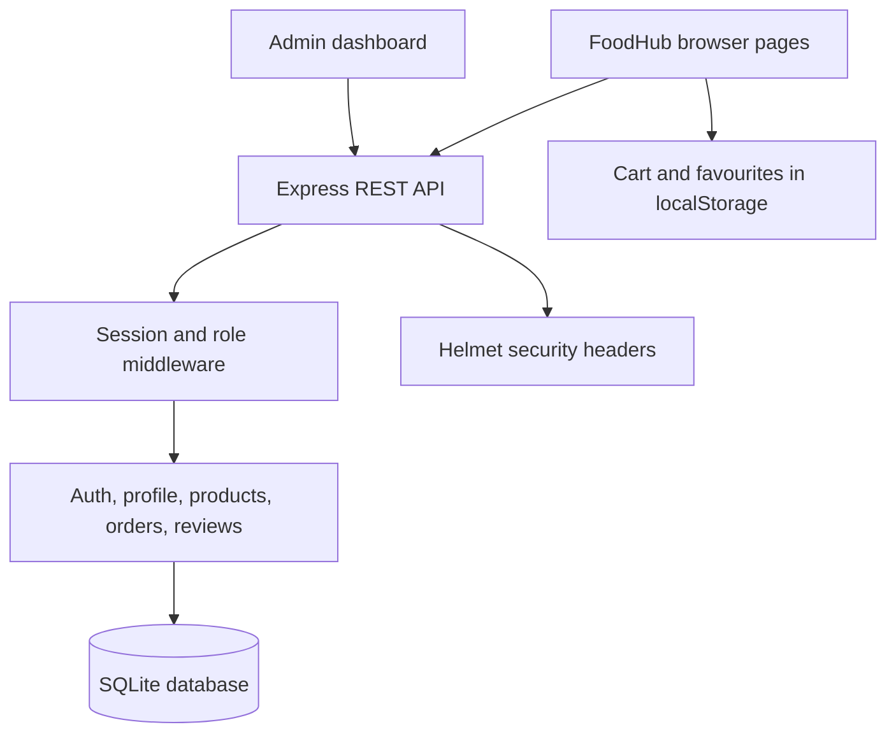

# FoodHub Cybersecurity Elective — Project Walkthrough

## 1. The problem

The original website was a food ordering application with cart items, favourites, reviews, customers, products, and orders. Browser storage and HTML rendering create security risks when data is treated as trustworthy. A user can edit `localStorage`, and review text may contain markup that should be shown as text rather than interpreted as code.

## 2. Project goal

Build and demonstrate a safer web application that:

1. Keeps accounts and business records in a server-side SQLite database.
2. Uses server-managed sessions and role checks for protected operations.
3. renders cart, favourites, and review text safely.
4. Recalculates order totals using the server's product catalogue.
5. Validates incoming API data and rejects untrusted browser origins for mutations.
6. Applies browser security headers and prevents direct downloads of backend/database files.
7. Provides repeatable tests and a manual evidence checklist.

## 3. Architecture

Cart and favourites are convenient browser-side selections, not trusted order data. The server looks up the selected products and calculates the final total when checkout is submitted.

## 4. Security controls to explain

### DOM-based XSS

**Risk:** code inserts localStorage values into `innerHTML`, so markup controlled by a browser user may be parsed.

**Mitigation:** create elements with `document.createElement`, put untrusted labels into `textContent`, and validate image URLs. Cart and favourites are localStorage values and must always be treated as untrusted.

### Stored XSS in reviews

**Risk:** review text is saved to SQLite, then later shown to customers or administrators. If it is parsed as HTML, a stored payload can affect every person who views it.

**Mitigation:** review text is persisted as data and rendered with text nodes. The admin view escapes dynamic values before template insertion. Review submissions are length-limited and rate-limited.

### Authentication and authorization

**Risk:** hiding admin links or changing a role in browser storage is not access control.

**Mitigation:** the server creates an HttpOnly session cookie and checks the session role on admin APIs. Customers cannot access admin orders, customer records, or product-write endpoints.

### Price manipulation

**Risk:** a browser user can edit cart prices and quantities in DevTools.

**Mitigation:** the API accepts product names and quantities, looks up trusted prices in SQLite, checks quantity limits, and calculates the total server-side.

### CSRF/CORS and browser boundaries

**Risk:** a malicious site may attempt to make requests using a signed-in browser.

**Mitigation:** CORS grants access only to configured origins; mutation requests carrying an Origin must be same-origin or explicitly allowed; session cookies are HttpOnly and SameSite=Lax. CORS alone is not authentication and is not a substitute for authorization.

### Security headers and static file exposure

**Risk:** weak browser policy may permit unwanted content or framing; a static server can accidentally expose implementation files or the database.

**Mitigation:** Helmet sets CSP and other headers, CSP disallows objects and framing, and requests for backend, Git metadata, and test paths are denied by the static server.

## 5. Demonstration scenario

**Scenario:** A customer signs up, saves two dishes, places an order, and submits a review. An administrator views the customer/order/review and manages products.

1. Start the server and sign up as a customer.
2. Favourite a dish on Home, then favourite another dish on Menu.
3. Open Account → My Favourites and show both dishes. Remove one and reload.
4. Add a product to the cart, change quantity, and proceed to checkout. Explain that the backend recalculates price and total.
5. Place the order and show it in Account → My Orders.
6. Sign in as admin and show the customer and order in the dashboard.
7. Submit a harmless review test string: ` `.
8. Show that it is displayed as literal text on customer and admin review views, not executed.
9. Run `npm test` and show the automated security test result.

## 6. Evidence to collect

- Screenshot of the passing `npm test` output.
- Screenshot of the saved favourites list.
- Screenshot of the review test string displayed literally.
- Screenshot of the order in the admin dashboard.
- Terminal output from the security-header `curl` command.
- Completed manual checklist in `SECURITY-TESTING.md` with actual results and date.

## 7. Honest limitations to state

- CSP still permits inline scripts for compatibility; a next step is to move inline code and event handlers into external scripts, then remove `'unsafe-inline'` or use nonces/hashes.
- EmailJS is browser-side and must be restricted by origin/template in its own dashboard.
- Sessions use Express's in-memory store and reset on restart; this is unsuitable for a production multi-instance deployment.
- The payment option is only a demo label; no real card payment integration exists.
- Automated tests prove only the cases they exercise. Complete and record the manual browser checklist before presenting the whole application as tested.
